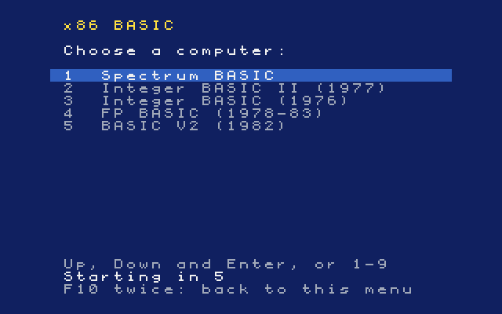
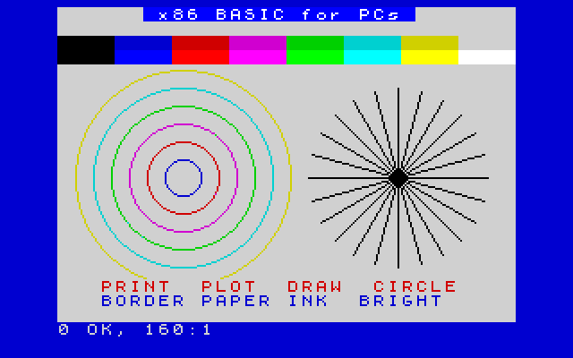
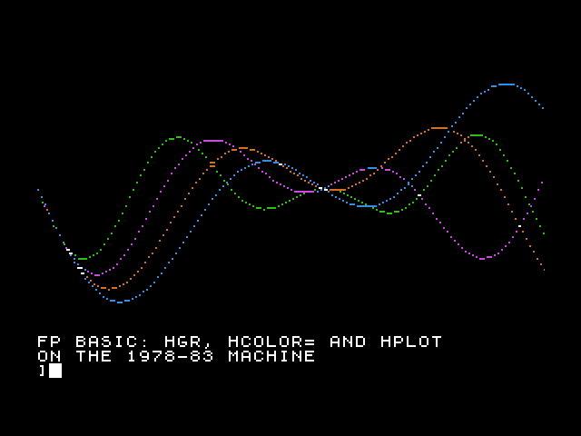
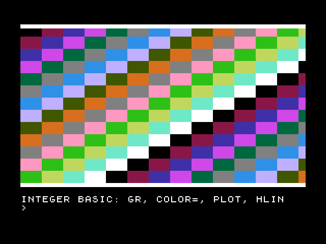
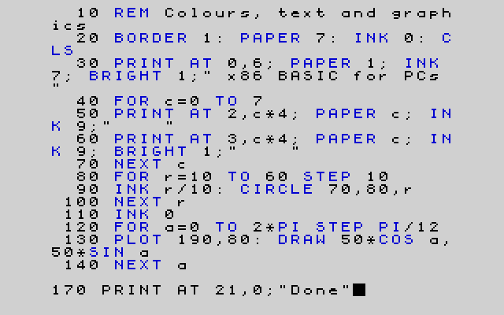
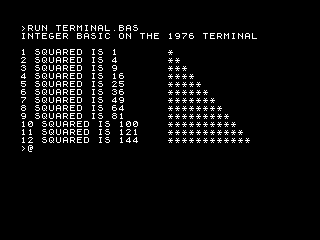
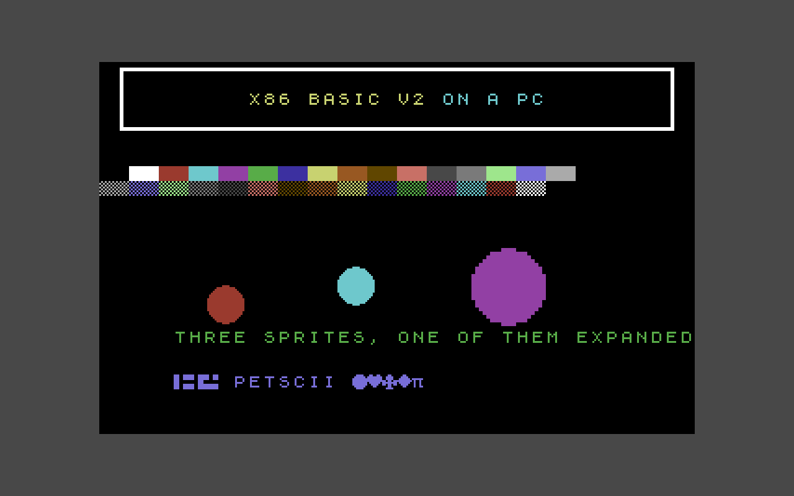

# x86-BASIC

Home-computer BASICs of the late 1970s and 1980s, for PCs. Boot it from
a USB stick and the PC starts straight into BASIC, like a home computer
from then: a ZX Spectrum-style machine, three for Apple I and Apple II
listings, or one for Commodore 64 listings, picked from a menu. There's no operating system
underneath: just a boot loader, a small kernel and the interpreter.

<table>
  <tr>
    <td></td>
    <td></td>
  </tr>
  <tr>
    <td align="center">The menu when the PC starts</td>
    <td align="center">Spectrum BASIC</td>
  </tr>
  <tr>
    <td></td>
    <td></td>
  </tr>
  <tr>
    <td align="center">FP BASIC, high resolution (for Applesoft listings)</td>
    <td align="center">Integer BASIC, low resolution (1977)</td>
  </tr>
</table>

The aim is that a listing — from a magazine, a book or a manual — can
be typed in and gives the same result as on the real computer. They
aren't emulators: they don't run Z80 or 6502 machine code, tapes or
snapshots, and they contain nothing of the originals' ROMs. Each BASIC
is a new implementation, and the character sets were drawn for this
project.

- **Spectrum BASIC** (see [Using it](#using-it)): the Spectrum's
  screen, 32×24 characters on a 256×192 picture inside a coloured
  border, eight colours with BRIGHT and FLASH; its numbers, strings and
  slicing, arrays, DEF FN, READ/DATA, graphics, BEEP and PLAY, PEEK and
  POKE, user-defined graphics and error reports, at about the
  Spectrum's speed; a line editor with cursor keys and history
- **Integer BASIC**, on the 1976 terminal computer (Apple I) and on the
  1977 colour one (Apple II), and **FP BASIC**, the floating-point BASIC
  of 1978–83, for Applesoft listings (Apple II Plus and IIe): their text,
  low- and high-resolution graphics, shapes and DOS 3.3-style disk
  commands (see [The Apple-style machines](#the-apple-style-machines))
- **BASIC V2**, the 1982 64KB home computer's, for Commodore 64
  listings: its full-screen editor and PETSCII, the VIC-II's modes and
  sprites, the SID on the PC speaker, the keyboard and joysticks, and
  the disk drive's files (see [The BASIC V2 machine](#the-basic-v2-machine))
- SAVE/LOAD to files on the boot disk, which any PC can read
- One disk image that boots on both old (BIOS) and new (UEFI) PCs, from
  a USB stick, hard disk or floppy, with a menu to choose the machine
  (or an image with just one)

## Quick start

1. Download `x86-basic-VERSION.img` from the
   [Releases page](https://github.com/jasontrainor/x86-BASIC/releases/latest)
   (or build it: see [Build and run](#build-and-run)).
2. Try it in QEMU, or write it to a USB stick and boot a PC from it
   (see [Booting a real PC from a USB stick](#booting-a-real-pc-from-a-usb-stick)).
3. Pick a machine from the menu (or wait 5 seconds for the Spectrum),
   and type a program in:

       10 FOR n=0 TO 6
       20 PRINT INK n;"Hello, world"
       30 NEXT n
       RUN

   On the Apple-style machines (where Integer BASIC wants an `END`):

       10 FOR N = 1 TO 7: PRINT "HELLO, WORLD": NEXT N
       20 END
       RUN

   On the BASIC V2 machine (typed in lower case, which it shows as
   capitals):

       10 for n=1 to 7:poke 646,n:print "hello, world":next
       run

4. `SAVE "hello"` keeps it on the stick and `LOAD "hello"` brings it
   back (`SAVE HELLO` and `LOAD HELLO` on the Apple-style machines,
   `SAVE "HELLO",8` and `LOAD "HELLO",8` on the BASIC V2 machine).
   **F10 twice** goes back to the menu.

## Contents

- [Download](#download)
- [Build and run](#build-and-run)
- [Machines and the chooser](#machines-and-the-chooser)
- [Using it](#using-it) (Spectrum BASIC): [editing](#editing),
  [typing Spectrum characters](#typing-spectrum-characters),
  [the language](#the-language), [reports](#reports),
  [memory, PEEK and POKE](#memory-peek-and-poke), [speed](#speed),
  [differences from a Spectrum](#differences-from-a-spectrum)
- [Saving programs](#saving-programs): [listings as text files](#listings-as-text-files),
  [the printer](#the-printer)
- [The Apple-style machines](#the-apple-style-machines):
  [Integer BASIC](#integer-basic), [FP BASIC](#fp-basic),
  [disk commands](#disk-commands)
- [The BASIC V2 machine](#the-basic-v2-machine): [keys](#keys-1),
  [the language](#the-language-1), [the disk and files](#the-disk-and-files)
- [Booting a real PC from a USB stick](#booting-a-real-pc-from-a-usb-stick)
- [Tests](#tests), [Making a release](#making-a-release),
  [How it works](#how-it-works)

## Download

Ready-made disk images are on the
[Releases page](https://github.com/jasontrainor/x86-BASIC/releases/latest):
`x86-basic-VERSION.img` has every machine, with a menu, and
`x86-basic-VERSION.zip` has that and one image per machine, with
instructions. Write one to a USB stick (see
[Booting a real PC from a USB stick](#booting-a-real-pc-from-a-usb-stick)),
or try it in QEMU:

    qemu-system-x86_64 -drive file=x86-basic-VERSION.img,format=raw,if=floppy -boot a

## Build and run

You need `nasm`, `gcc`, GNU `ld` and `make` (the GNU toolchain of any
Linux distribution), `python3`, and `qemu-system-x86_64` to try it out.
For UEFI, also the OVMF firmware (the `ovmf` package).

    make              # builds os.img
    ./run.sh          # boot it in QEMU as a floppy disk (BIOS)
    ./run.sh usb      # boot it as a USB stick (BIOS)
    ./run.sh uefi     # boot it as a USB stick on a UEFI PC

On Debian or Ubuntu: `sudo apt install build-essential nasm python3
qemu-system-x86 ovmf`.

## Machines and the chooser

x86 BASIC is built to hold more than one kind of computer ("machine"),
each in `machines/NAME/`:

| Machine    | The menu calls it         | For listings written for              |
|------------|---------------------------|---------------------------------------|
| `spectrum` | Spectrum BASIC            | the ZX Spectrum (48K and 128K BASIC)  |
| `a1basic`  | Integer BASIC (1976)      | the Apple I's Integer BASIC           |
| `a2int`    | Integer BASIC II (1977)   | the Apple II's Integer BASIC          |
| `a2fp`     | FP BASIC (1978-83)        | Applesoft, on an Apple II Plus or IIe |
| `c64`      | BASIC V2 (1982)           | the Commodore 64's BASIC V2           |

When the PC starts, a small chooser comes first and starts a machine:
straight away if the image has only one, or from a menu if it has
several (pictured [at the top](#x86-basic)): the arrow keys and Enter,
or a number, pick one.

    make                              # os.img, with every machine
    make image-spectrum               # build/images/spectrum.img: one machine
    make image-a2fp                   # ... or any other
    make IMAGE_MACHINES="spectrum" DEFAULT=spectrum MENU=always TIMEOUT=10

On the stick, each machine is a pair of kernels in the `X86BASIC` folder
of the FAT partition (`NAME.SYS` for the BIOS, `NAME.EFI` for UEFI), and
keeps its own files in a folder named after it (`SPECTRUM/`). A text
file at the top, `BOOT.CFG`, says what the menu calls them and which to
start; it can be edited on any PC:

    DEFAULT=SPECTRUM        the machine to start (else the first)
    MENU=AUTO               AUTO: a menu only if there's more than one
                            machine; ALWAYS; or NEVER
    TIMEOUT=5               seconds before the menu starts DEFAULT
                            (0: wait for a key)
    KEYBOARD=US             the keyboard's layout: US, UK, DE or FR
    SPECTRUM=Spectrum BASIC what the menu calls X86BASIC/SPECTRUM.*

PC firmware types as a US keyboard does, whatever the keycaps say, so
`KEYBOARD=` says what they do say (`make KEYBOARD=uk`, or
`tools/mkimage.py --keyboard uk`, builds an image with it). AltGr works
for the characters it types (`@` on a German keyboard is AltGr+Q), and
the £ key gives the Spectrum's pound sign (`#` on the Apple-style
machines); letters with accents type nothing, since the machines have
none. UEFI firmware can't tell the extra key beside the left Shift from
the one beside Enter, so on UEFI PCs they type the same: on a UK
keyboard `#` and `~` (and AltGr+`#` types `\`), on German and French
ones `<` and `>`.

Copying a machine's two kernel files onto a stick adds it to the menu,
and deleting them takes it away. To get to the menu anyway, hold
**Shift** while the PC starts (BIOS), or press **F10 twice** in any
machine, which goes straight back to it. The image is 1.44MB (so it
works as a floppy) if everything fits with room to spare, else 16MB.

## Using it

As on a Spectrum, lines are typed at the bottom of the screen (the lower
screen). A line with a number goes into the program, which is then listed
above, with `>` marking the line just entered. A line without a number
runs straight away. Either way, when it's done a report appears at the
bottom — `0 OK, 0:1`, or `2 Variable not found, 30:2` (line 30,
statement 2) — and stays until a key is pressed. A number on its own
deletes that line, and Enter on its own lists the program again.

Each line is checked when Enter is pressed, as on the Spectrum. If it
doesn't make sense, it isn't stored or run: it stays in the editor with
a flashing `?` where it goes wrong, to be corrected (or Esc to abandon
it). The check is for the form of the line: whether variables exist,
numbers are in range and so on is only known when it runs.

Keywords are typed in full, in any case: `print`, `GO TO`, `goto`. Press
**Esc** (or **Ctrl+C**) for BREAK; `CONTINUE` carries on.

   
  <em>A program listed, with its keywords in colour, and a new line being typed at the bottom</em>

### Editing

| Key | |
|---|---|
| ← → Home End | move along the line |
| Backspace, Delete | delete before / at the cursor |
| ↑ ↓ | recall earlier lines |
| Enter | done; Esc abandons the line |

`EDIT 20` brings line 20 back to change it (`EDIT` alone: the last line
entered). `LIST` shows keywords in colour. Lines can be up to 760
characters long; the lower screen grows upwards to hold them.

### Typing Spectrum characters

The Spectrum's keyboard could type characters a PC's can't. In strings
(and `REM` text), they are written as escapes, the same ones the `zmakebas` tool uses for
Spectrum listings:

| | |
|---|---|
| `"\a"` … `"\u"` | the user-defined graphics A–U (`CHR$ 144`–`164`) |
| `"\::"`, `"\'."`, `"\  "` … | block graphics (`CHR$ 128`–`143`): two characters for the left and right halves of the cell, each `'` (top), `.` (bottom), `:` (both) or a space |
| `"\*"` | © (`CHR$ 127`) |
| `"\{n}"` | character *n* |
| `"\\"` | a backslash |
| `` ` `` | £ (`CHR$ 96`, as on the Spectrum) |

A quote inside a string is written `""`, as on the Spectrum.

### The language

It's the Spectrum's BASIC; a quick summary:

| | |
|---|---|
| `PRINT`, `LPRINT` | items separated by `;` (together), `,` (next half-line) or `'` (new line); `AT row,col`, `TAB col`; colours (`PRINT INK 2;"RED"`) last for that `PRINT`. `PRINT #1;` prints in the lower screen. `LPRINT` (and `PRINT #3`), `LLIST` and `COPY` print on the printer: see below. |
| `LET` | numbers and strings; numeric names can be long and contain spaces (`LET hi score=0`) |
| `DIM a(10,10)`, `DIM a$(5,10)` | arrays from 1; a string array holds fixed-length strings, as on the Spectrum: `DIM a$(10)` is one string of 10 characters |
| `a$(2 TO 4)`, `LET a$(3)="X"` | slicing, and assigning to a slice (padded or cut to fit) |
| `PLAY` | the Spectrum 128's music strings (notes `a`–`g` and `A`–`G`, `#` `$`, `&`, lengths `1`–`12`, `O`, `T`, `( )`, `!…!`, `H`). The PC speaker has one voice, so the first three strings (channels A, B and C) take turns where their notes sound together, 20ms each, as Spectrum games did for chords; strings 4–8 (MIDI) aren't heard, and volume and envelopes are ignored. |
| `INPUT` | in the lower screen, with prompts, `AT`, colours and `LINE`; numbers can be typed as expressions, strings between quotes |
| `IF ... THEN`, `FOR ... TO ... STEP`, `NEXT`, `GO TO`, `GO SUB`, `RETURN`, `STOP`, `CONTINUE` | as on the Spectrum (`GO TO` a missing line goes to the next one) |
| `READ`, `DATA`, `RESTORE`, `DEF FN`, `FN`, `RANDOMIZE`, `PAUSE`, `BEEP`, `REM` | |
| `CLS`, `INK`, `PAPER`, `BORDER`, `BRIGHT`, `FLASH`, `INVERSE`, `OVER` | colours 0–7, 8 (leave as it is) and 9 (contrast) |
| `PLOT`, `DRAW x,y[,angle]`, `CIRCLE`, `POINT` | x 0–255, y 0–175 from the bottom |
| `PEEK`, `POKE`, `USR "a"`, `IN`, `OUT` | see below |
| `RUN`, `LIST`, `NEW`, `CLEAR`, `SAVE`, `LOAD`, `VERIFY`, `MERGE` | `RUN` and `CLEAR` also clear the screen |

Functions: `ABS INT SGN SQR SIN COS TAN ATN ASN ACS LN EXP PI RND`, `LEN
VAL VAL$ CODE CHR$ STR$ BIN INKEY$ ATTR SCREEN$ POINT PEEK IN USR`. As on
the Spectrum, a function applies to the next item (`SQR 4*3` is 6), `^`
is power, comparisons give 1 or 0, and `a$ AND x` is `a$` if `x` is
true, otherwise `""`.

Numbers are printed as the Spectrum prints them (8 significant digits,
`1.2345679E+8`, `0.5` but `.05`), and `RND` uses the Spectrum's formula:
from power-on it gives the same sequence a Spectrum would.

Beyond the Spectrum: `END`, `EDIT`, `CAT`, `ERASE`, `IF ... THEN 100`,
long string variable names, and strings of up to 65535 characters; and
`RENUMBER [start[,step]]` (10, 20 ... if not given), as the Spectrum
128's editor does from its menu: the numbers after `GO TO`, `GO SUB`,
`RUN`, `LIST`, `RESTORE`, `LINE` and `THEN` change with the lines (but
not ones worked out, such as `GO TO n*10`).

### Reports

The Spectrum's reports and codes: `0 OK`, `1 NEXT without FOR`, `2
Variable not found`, `3 Subscript wrong`, `4 Out of memory`, `5 Out of
screen`, `6 Number too big`, `7 RETURN without GO SUB`, `9 STOP
statement`, `A Invalid argument`, `B Integer out of range`, `C Nonsense
in BASIC`, `D BREAK - CONT repeats`, `E Out of DATA`, `F Invalid file
name`, `G No room for line`, `H STOP in INPUT`, `I FOR without NEXT`, `K
Invalid colour`, `L BREAK into program`, `N Statement lost`, `O Invalid
stream`, `P FN without DEF`, `Q Parameter error`, and `R` for problems
with the disk.

When the upper screen fills, it asks `scroll?` (N, Space or Esc stop),
as the Spectrum does; `POKE 23692,255` holds that off for 255 lines.

### Memory, PEEK and POKE

`PEEK` and `POKE` see a 64KB memory laid out as the Spectrum's:

- the screen's pixels at 16384–22527 and its colours at 22528–23295, in
  the Spectrum's order: they *are* the screen
- the system variables programs use, at their Spectrum addresses: `CHARS`
  (23606, a character set of your own), `UDG` (23675), `SEED`, `FRAMES`
  (23672, counts 50 a second), `COORDS`, `SCR_CT`, `ATTR_P`, `LAST_K`,
  `FLAGS2` (`POKE 23658,8` for capitals) and others
- the character set at 15616–16383, where the Spectrum's ROM keeps one
  (this project's own font); the rest of the "ROM" reads 0
- the user-defined graphics at 65368 (`USR "a"`), starting as copies of
  the letters A–U
- ordinary memory for the rest

BASIC keeps its program and variables elsewhere, so PEEKing the program
area doesn't find them. `USR` with a number can't run machine code (`USR
0` starts afresh, as it does on a Spectrum). `IN` reads the keyboard
ports as the Spectrum's do (see [differences](#differences-from-a-spectrum)
for which PC keys are which), and `OUT 254,n` sets the border.

### Speed

A PC runs BASIC thousands of times faster than a Spectrum, which would
make delay loops and games far too fast, so programs are held back to
about the Spectrum's speed: a `FOR` loop of 1000 takes about 4.4 seconds,
as it does on a Spectrum. `POKE 23681,1` (a system variable the Spectrum
doesn't use) runs at full speed; `POKE 23681,0` goes back.

### Differences from a Spectrum

- Numbers have the Spectrum's precision (32 bits) and range (up to about
  1.7E38, and down to about 2.9E-39, below which they're 0), so rounding
  drift and overflow happen where they would there. But the arithmetic
  and functions are the PC's, rounded to that precision, not the
  Spectrum ROM's own routines, so a last digit can still occasionally
  differ.
- Keywords are typed as words, so a variable named like one is only
  possible for keywords that can't start a value: `LET to=1`, `FOR
  step=1 TO 3`, `PRINT line` work (and list as `LET TO =1`), but not
  names that are functions (`len`, `int`), and `PRINT at` is `PRINT AT`.
- No machine code: `USR` addresses, `RANDOMIZE USR`, and `LOAD "" CODE`
  followed by a call don't run anything.
- `IN` sees the keys held down where the PC says which they are (the
  BIOS version), with the PC's keys where the Spectrum's are: Shift is
  CAPS SHIFT, Ctrl (or AltGr) SYMBOL SHIFT, and the arrows and
  Backspace are CAPS SHIFT with 5–8 and 0, as on the later Spectrums.
  UEFI firmware only reports keys going down, so there `IN` counts the
  last key typed as held for a moment after each press (or repeat).
  `INKEY$` returns each press (and repeat) once.
- No microdrives or other Interface 1 commands; `OPEN #`, `CLOSE #`,
  `FORMAT` and `MOVE` aren't there. The printer is a text file.
- Speed is matched on average, statement by statement, not exactly.

## Saving programs

The boot disk stands in for a tape: `SAVE "name"` writes the program to
the disk the computer booted from and `LOAD "name"` reads it back (`LOAD
""` loads the first program). `SAVE "name" LINE 10` makes `LOAD` run it
from line 10. `SAVE "name" CODE start,length` and `SAVE "name" SCREEN$`
save memory or the screen, loaded back with `LOAD "name" CODE [start]`
and `LOAD "name" SCREEN$`. `SAVE "name" DATA a()` (or `a$()`) saves an
array, and `LOAD "name" DATA b()` loads it back, under any name.
`VERIFY` checks a save, `MERGE` adds a saved program's lines to the one
in memory, `CAT` lists what's saved, and how much room is left, and
`ERASE "name"` deletes one. Names are up to 15 characters. The Spectrum
128's RAM disk commands (`SAVE !"name"`, `LOAD !`, `MERGE !`, `CAT !`,
`ERASE !`) work too: the disk stands in for the RAM disk as well.

Each saved file is a file of its own in the `SPECTRUM` folder of the
stick's FAT partition, so saves persist, the BIOS and UEFI versions share
them, and they can be backed up or copied to another stick on any PC.
The file's name comes from the saved name: its first 8 letters and
digits, with `.SAV` (`SAVE "my game"` makes `MY_GAME.SAV`; names that
would clash get `~1`, `~2` ...). `tools/savefile.py info FILE.SAV` says
what one holds. Rebuilding `os.img` with `make` starts with no saves.

Programs on Spectrum tape files (`.tap` and `.tzx`, as archives of
type-in listings have them) can be copied out for the stick, without
retyping them:

    tools/tap.py list game.tap
    tools/tap.py extract game.tap out/      # then copy out/* to SPECTRUM/

Each BASIC program becomes a listing (`GAME.BAS`: `LOAD "game.bas"`, and
the line it started at is in a comment at the top), with the Spectrum's
characters written as the escapes above, and bytes (`CODE`, `SCREEN$`)
become saved files, loaded by the name they had on the tape
(`LOAD "udg" CODE`). Machine code in them can't run, and arrays aren't
converted.

Files saved before saves moved into the FAT partition can be copied out
of an old image with `tools/savefile.py convert old.img DIR`, then
copied into `SPECTRUM/` on the stick (or onto a new image with
`make LISTINGS="DIR/*.SAV"`).

### Listings as text files

A name ending `.BAS` or `.TXT` is a text file on the stick's FAT
partition, the one any PC shows when the stick is plugged in. So a
listing can be typed or fixed up in a PC's text editor, copied onto the
stick, and loaded: `LOAD "game.bas"` (or `MERGE`). `SAVE "game.bas"`
writes the program out as text, to take back to a PC, and `VERIFY`,
`ERASE` and `CAT` work too. Names are DOS 8.3 names, in the `SPECTRUM`
folder (which is made when it's first saved to).

`tools/check.py game.bas` checks a listing on a PC before it goes on the
stick: it types each line into the BASIC (built for the PC, as for the
tests) and lists any it refuses, with the `?` where it goes wrong;
`--run` also runs it and prints what it shows, and `--machine a2int`
(or `a1basic`, `a2fp`) checks a listing for one of the Apple-style
machines. FP BASIC only finds a mistake when the line runs, so for it
`--run` is the check.

The text is as `LIST` shows it, a line per line, with the characters a
PC can't show written as the escapes above (zmakebas's). Reading one,
blank lines and lines starting with `#` are skipped, and a `\` at the
end of a line joins the next one on. Each line is checked as if typed;
the first that doesn't make sense is reported and put in the editor,
with its `?`, to be put right.

`make LISTINGS="game.bas other.bas"` puts listings on the image when it's
built. The FAT partition can be FAT12 or FAT16, of any size.

### The printer

`LPRINT`, `LLIST` and `COPY` print on a pretend ZX Printer: the text
file `SPECTRUM/PRINTOUT.TXT` on the FAT partition, 32 characters to a line. Each
command or program adds what it printed to the end of the file (which
keeps its last 64KB). The pound sign, © and block graphics come out as
their Unicode characters, and UDGs as the letters they start as. `COPY`
prints the text on the screen; pictures don't come out.

## The Apple-style machines

Three machines run listings written for Apple's BASICs of 1976–83. As
with the Spectrum, they aren't emulators: they don't run 6502 machine
code, and nothing in them comes from an Apple ROM, character set, disk
or manual text. The BASICs were written for this project from how the
originals behave, the characters are this project's own font, and the
colours were worked out for it. "Apple", "Apple II" and "Applesoft" are
trademarks of Apple Inc., used here only to say what listings these
machines are for; the machines themselves have neutral names.

Each starts at its prompt, with no banner: `>` for Integer BASIC, `]`
for FP BASIC. Its files go in its own folder on the stick (`A1BASIC/`,
`A2INT/`, `A2FP/`).

<table>
  <tr>
    <td></td>
    <td></td>
    <td></td>
  </tr>
  <tr>
    <td align="center"><code>a1basic</code>: Integer BASIC (1976)</td>
    <td align="center"><code>a2int</code>: Integer BASIC II (1977)</td>
    <td align="center"><code>a2fp</code>: FP BASIC (1978–83)</td>
  </tr>
</table>

### Keys

- **Typing a line** (on the 1977 and later machines) works as their
  monitor reads it: the left
  arrow backs up, the right arrow copies the character under the cursor
  from the screen, Esc then I J K M (or the arrows) moves the cursor
  around the screen without typing, and Ctrl+X cancels the line.
- **Ctrl+C** stops a program (BREAK, STOPPED AT); CONT or CON carries on.
- **Paddles and buttons:** a PC has no paddles, so the arrow keys move
  paddle 0 (left, right) and paddle 1 (up, down), 16 steps at a time,
  for `PDL`. The buttons (`PEEK(-16287)` to `-16285`) are the left Alt,
  right Alt (AltGr) and Shift keys (on UEFI PCs, as far as the
  firmware says: most say, a few only while another key is pressed).
- **Any key down:** on the later model, bit 7 of `PEEK(-16368)` is set
  while a key is held (BIOS PCs; on UEFI, while one is waiting).
- **F10 twice** goes back to the chooser, as in every machine.

### What the three share

The hardware programs see, in `machines/apple/`:

- **Memory and soft switches:** 64KB, plus the IIe's 64KB of auxiliary
  memory, with the I/O switches at `$C000`–`$C0FF`: the keyboard
  (`PEEK(-16384)`, cleared by `POKE -16368,0`), the speaker click
  (`-16336`), text/graphics, mixed, page 2, high resolution, and the
  IIe's 80STORE, RAMRD, RAMWRT, ALTZP, 80COL, ALTCHARSET and double
  resolution. The bytes programs read to tell the models apart (`$FBB3`,
  `$FBC0`) are there; the rest of the ROM's addresses read as 0.
- **The screen,** drawn from memory as the video hardware does it: 40
  or 80 columns of text (inverse, flashing, the IIe's lower case and
  MouseText symbols drawn for this project), low resolution (40×48, 16
  colours), high resolution (280×192, with the colours a TV makes of
  the dot patterns), the IIe's double resolution, mixed text and
  graphics, and page 2. It's a 560×192 picture shown twice as tall; on
  the BIOS that's VGA mode 12h (640×480, 16 colours).
- **The text window** lives in zero page, as on the originals: `POKE
  32,10` moves its left edge, `PEEK(36)` is the cursor's column.
- **CALL:** the firmware routines programs call are done here instead:
  `CALL -936` (clear the screen), `-958`, `-868`, `-922`, `-912`, `-198`
  (the bell), `-1008`, `-998`, `-1036`, `-384`/`-380` (inverse/normal),
  `-1998`/`-1994` (clear low resolution), `-1216`, `-1233`, `-756`
  (wait for a key), and in FP BASIC `62450`/`62454` (clear or fill high
  resolution). A CALL to anything else, such as machine code a program
  POKEd in, does nothing, and the program carries on, with one
  exception: the little tone routine so many listings POKE in for their
  sound (`POKE 768,pitch: POKE 769,length: CALL 770`, its 21 bytes
  wherever they're put) is recognised, and plays its tone. Games with
  sound routines of their own run silently.

### Integer BASIC

`a2int` is the 1977 colour machine's Integer BASIC; `a1basic` is the
same language on the 1976 terminal computer.

- Numbers are integers from -32767 to 32767; going outside that is
  `*** >32767 ERR`. `/` truncates; `MOD`; `#` and `<>` both mean not
  equal; comparisons are 1 or 0.
- Names are a letter then letters and digits, all significant. Strings
  are DIMmed with the longest they may be (`DIM A$(20)`, up to 255), and
  `A$(3)`, `A$(3,5)` are parts of them; there's no `+` for strings:
  `A$(LEN(A$)+1)="MORE"` adds to the end. Arrays have one subscript,
  from 0.
- Lines are checked as they're typed (`*** SYNTAX ERR`, and the line
  isn't kept). Errors in a program show `STOPPED AT n` too.
- Things programs depend on are kept: when IF's condition is false only
  the statement after THEN is skipped, and statements after it on the
  line still run; a program must END (`*** NO END ERR`); GOSUBs and FOR
  loops nest 8 deep; INPUT of a number takes an expression; GOTO and
  GOSUB take expressions.
- Statements and functions: LET PRINT INPUT IF THEN GOTO GOSUB RETURN
  FOR TO STEP NEXT END REM DIM POKE CALL TAB CLR NEW RUN LIST DEL AUTO
  MAN CON HIMEM: LOMEM: PR# IN#, ABS SGN RND PEEK LEN, AND OR NOT MOD;
  and on the 1977 machine also GR COLOR= PLOT HLIN VLIN SCRN( TEXT VTAB
  PDL ASC POP DSP TRACE NOTRACE.

The **1976 terminal** (`a1basic`) shows 40×24 upper-case characters that
only scroll, with a flashing `@` for a cursor, at the original's 60
characters a second; **Tab** switches between that and as fast as it
goes. `_` or Backspace rubs out a character (showing a `_`), and Esc or
Ctrl+X cancels the line. Its keyboard and display are at `$D010`–`$D013`
(`PEEK(-12271)` is 128 while a key is waiting); it has no graphics, no
cursor moves and no soft switches.

### FP BASIC

`a2fp` is the floating-point BASIC (for Applesoft listings), on the
later model: lower case, and 80 columns after `PR#3`.

- Numbers have 32 significant bits and print with up to 9 digits, as on
  the original: `1/3` is `.333333333`, `1E9` is `1E+09`, `.001` is
  `1E-03`. `A%` is an integer (-32767 to 32767), `A$` a string (up to
  255 characters).
- Only the first two characters of a name count, and keywords are found
  anywhere in a line as it's typed, even inside names, as on the
  original: `SCORE` is `SC OR E` (a SYNTAX ERROR when assigned to), and
  `FORI=ATOB` is `FOR I = A TO B`. Spaces are taken out, except in
  strings, REM and DATA; LIST puts them back around keywords and
  operators.
- Lines aren't checked until they run (`?SYNTAX ERROR IN 20`).
- The language: arrays of any shape (11 elements a subscript if not
  DIMmed), the string functions, DEF FN, ON GOTO/GOSUB, READ/DATA/
  RESTORE, INPUT (with `?REENTER` and `?EXTRA IGNORED`), GET, ONERR GOTO
  and RESUME (`PEEK(222)` is the error's number, `PEEK(218)+256*PEEK(219)`
  its line, `POKE 216,0` turns it off), STOP/CONT, TRACE, WAIT, SPEED=,
  HOME, HTAB, VTAB, INVERSE, FLASH, NORMAL, TAB(, SPC(, POS, FRE.
  `FRE(0)` is the room the original would have left, below HIMEM, for
  the program and variables there are (and, as there, a negative number
  when that's over 32767: add 65536).
- Graphics: GR, COLOR=, PLOT, HLIN, VLIN, SCRN( and HGR, HGR2, HCOLOR=,
  HPLOT ... TO, and shapes from a shape table (DRAW, XDRAW, ROT=,
  SCALE=). The eight HCOLORs behave as on the original: green plotted
  on an even column comes out black.

### Disk commands

Both BASICs have DOS 3.3-style commands, typed at the prompt or printed
by a program after a Ctrl+D (`PRINT CHR$(4);"CATALOG"`):

- CATALOG, SAVE, LOAD, RUN *name*, DELETE, RENAME *old*,*new* (LOCK
  and UNLOCK are accepted, but files aren't locked);
- text files: OPEN, READ, WRITE, APPEND, POSITION, CLOSE (with `,R`,
  `,B` and `,L`; INPUT and GET read from the file, PRINT writes to it);
- EXEC (a file's lines, as if typed), BSAVE *name*`,A`*addr*`,L`*len*,
  BLOAD and BRUN (which loads, but can't run machine code);
- MON, NOMON, MAXFILES, VERIFY and INIT are accepted; INT and FP say
  `LANGUAGE NOT AVAILABLE` for the other BASIC, since each is its own
  machine here.

Errors are DOS's (`FILE NOT FOUND`, `END OF DATA` ...), and FP BASIC's
ONERR catches them with DOS's numbers. Names can be up to 30 characters,
as on DOS. Files are saved files in the machine's folder, so
they can be copied between sticks; a listing or text file copied there
from a PC can be RUN, EXECed or OPENed by its 8.3 name (`RUN GAME.BAS`).

Programs, text files and binary files on DOS 3.3 disk images (140KB
`.dsk` or `.do` files) can be copied out for the stick:

    tools/dsk.py list games.dsk
    tools/dsk.py extract games.dsk out/     # then copy out/*.SAV to A2FP/

Programs become listings: FP BASIC ones (`A` in the catalog) for `A2FP/`,
Integer BASIC ones (`I`) for `A2INT/` (or `A1BASIC/`).

And the other way, files from the stick onto a disk image, for an
emulator or a real disk drive:

    tools/dsk.py pack mine.dsk A2FP/*.SAV A2FP/*.BAS

Saved files keep their names, and listings and text files are named
without their `.BAS` or `.TXT`. FP BASIC programs are tokenized as the
original does; Integer BASIC ones are left out, since its tokens depend
on its grammar (`EXEC` them as text files instead).

### Not the same as the originals

- No 6502: machine code a program POKEs in and CALLs doesn't run, and
  `&` and `USR` are errors. Sound made by clicking the speaker
  (`PEEK(-16336)` in a loop) works, at the pitch the interpreter's speed
  gives it.
- No cassette tape: LOAD, SAVE, SHLOAD, STORE and RECALL without a name
  do nothing.
- ROT= turns shapes to the nearest quarter turn.
- Undimensioned Integer BASIC strings can be up to 255 characters, and
  arrays 0–10.
- `make image-a2video` builds a test machine for the screen and keyboard
  (`machines/a2video/`), with commands such as `HGR`, `BARS`, `80` and
  `CHARS`.

## The BASIC V2 machine

`c64` runs listings written for the BASIC V2 of the 1982 64KB home
computer (the Commodore 64). As with the others, it isn't an emulator:
it doesn't run 6502 machine code, and nothing in it comes from the
original's ROMs, character sets or manuals. Its BASIC was written for
this project from how the original behaves (it shares its language core,
`machines/msbasic/`, with FP BASIC, its close relative); its characters
were drawn for it (`tools/mkc64chars.py`), from the project's font and
rules for the lines and blocks; and its sixteen colours were chosen for
it. "Commodore" and "Commodore 64" are trademarks of their owners, used
here only to say what listings this machine is for; the machine itself
has a neutral name and banner.

<table>
  <tr>
    <td></td>
  </tr>
  <tr>
    <td align="center"><code>c64</code>: BASIC V2 (1982), <code>docs/screenshots/SPRITES.BAS</code></td>
  </tr>
</table>

It starts as the original does, light blue on blue, with
`38911 BASIC BYTES FREE` and `READY.`, and keeps its files in the `C64`
folder on the stick. On UEFI PCs the picture has its border; the BIOS's
320x200 mode has no room for one, so there the picture fills the screen.

BASIC V2 has no statements for graphics, sound or the cursor: programs
POKE the chips and print control characters for those. So most of the
machine is a model of what programs POKE and PEEK
(`machines/c64hw/`):

- **The screen editor:** the cursor goes anywhere, and Return enters the
  line it's on (a logical line of up to 80 characters, two rows), so a
  line is changed by LISTing it, typing over it and pressing Return.
  Printing goes through it as on the original: PETSCII, with the control
  characters in strings doing the cursor work (`CHR$(147)` clears, 19
  homes, 17/145/29/157 move, 18/146 reverse, 5, 28, 30 ... colours, 14
  and 142 the character sets); after an odd number of quotes, or after
  INST, they show as reversed characters instead (quote mode). Its
  state is where programs expect it: 211 and 214 the cursor (`POKE
  214,R:PRINT` goes to row R+1), 646 the colour, 199 reverse, 198 and
  631-640 the key buffer (`POKE 631,13:POKE 198,1` types Return).
- **The VIC-II** at 53248: screen memory at 1024 and colour RAM at
  55296 (`POKE 1024,1` shows an A); border and background; text,
  multicolour text, extended background colour, bitmap and multicolour
  bitmap; the screen and characters wherever 53272 and the 16KB bank
  (56576) put them, characters in RAM (the usual loop copying the
  character ROM works, with this project's characters); fine scrolling,
  24 rows and 38 columns, blanking; the raster line (53266) for WAIT.
- **Sprites:** all eight, 24x21, expanded, multicolour, in front of or
  behind the characters, and the collision registers games read
  (53278, 53279).
- **The SID** at 54272: three voices with their envelopes, played on
  the PC speaker while the program goes on. The speaker plays one square
  wave, so it plays the loudest voice at each moment; noise jumps about;
  the filter and the waveforms' tone are lost. Voice 3 read back (54299)
  gives random numbers, as programs use it.
- **The keyboard and joysticks:** `PEEK(197)` is the key held (64 for
  none), `PEEK(653)` the shift keys, CIA 1 (56320, 56321) the keyboard
  matrix and the joysticks; and the CIAs' timers and time-of-day clocks.
- **SYS** to the firmware routines listings call is done here: 64738
  (reset), 65520 (PLOT, with 781-783 as the registers), 58640 and 58732
  (the cursor from 214 and 211), 65490 (CHROUT), 65508 (GETIN), 58692
  (clear the screen). Other addresses are machine code, which isn't run.

### Keys

| PC key | The original's key |
|---|---|
| a-z | its letters (shown as capitals): type programs in lower case |
| Shift with a letter (or Caps Lock) | the shifted letter: a graphics character, or a capital in the lower-case set (the original's Shift Lock does the same) |
| Esc | RUN/STOP |
| Page Up | RUN/STOP+RESTORE: stops the program and resets the screen and chips, keeping the program |
| Home, Shift+Home | HOME, CLR |
| Backspace, Delete | DEL |
| Shift+Backspace, End | INST |
| the arrows | the cursor keys |
| Shift+Return | moves to the next line without entering this one |
| right Alt with 1-8, 9, 0 | CTRL with them: the colours black to yellow, RVS ON, RVS OFF (Ctrl with them too, on UEFI) |
| left Alt with 1-8 | C= with them: the colours orange to light grey |
| Alt with a letter | C= with it: the graphics character on the left of the key |
| Shift with left Alt | switches the character sets |
| `\`, `` ` `` or `_`, `^`, `~` | £, ←, ↑, π |
| the arrows and right Ctrl | the joystick in port 2 (or port 1, with `JOYSTICK=1` in `BOOT.CFG`); on UEFI PCs, which can't say which keys are held, the arrows just typed count, without fire |
| F10 twice | back to the chooser |

### The language

BASIC V2's keywords, behaving as the original's do:

- Lines keep their spaces and are listed as typed; keywords are found
  inside names (`TOTAL` is `TO TAL`) and only two letters of a name
  count; keywords can be typed short, their first letters then the next
  shifted (`pO` is POKE, `?` PRINT).
- Numbers print with a space (or `-`) before them and a cursor right
  after; true is -1, and AND, OR and NOT work on the bits of 16-bit
  integers; `A%` is -32768 to 32767.
- `TI` counts sixtieths of a second, `TI$` is the time (`TI$="000000"`
  sets it), `ST` the status of the last file operation; `FRE(0)` goes
  negative above 32767; `RND(-n)` starts a sequence again, `RND(0)`
  takes one from the clock; `GET` doesn't wait.
- Errors read `?SYNTAX  ERROR IN 10`, then `READY.`; an empty line for
  `INPUT` leaves its variables as they were, a bad one gives
  `?REDO FROM START`.
- It runs at about the original's speed: a FOR loop of 1000 takes 1.1
  seconds. `POKE 2,1` (a byte the firmware leaves unused) runs at full
  speed; `POKE 2,0` goes back.

### The disk and files

The disk drive (device 8, and 9-11) and the tape (device 1) are the
`C64` folder on the stick:

    LOAD "GAME",8           a program            SAVE "GAME",8
    LOAD "DATA",8,1         bytes, at their own address (in a program,
                            it goes on from its first line, as there)
    LOAD "$",8 : LIST       the directory        LOAD "*",8   the first file
    LOAD "GAME.BAS",8       a text listing, or any file by its DOS name
    OPEN 2,8,2,"SCORES,S,W" : PRINT#2,S : CLOSE 2     (and ,S,R INPUT#, GET#)
    OPEN 15,8,15,"S0:OLD" : CLOSE 15                  the drive's commands
    OPEN 15,8,15 : INPUT#15,E,E$,T,S                  its error channel
    OPEN 4,4 : CMD 4 : LIST                           the printer: PRINTOUT.TXT

Programs are saved as `.PRG` files (their load address, then their bytes
as the original keeps them), which emulators and tools read, with DOS
names: letters, digits, `-` and `_`, and for a longer name its first six
and last two characters (`MY GAME PART 2` is `MYGAMET2.PRG`). LOAD also
reads `.P00` files and listings as text (`.BAS`, `.TXT`), with the
characters a keyboard hasn't written in braces, as printed listings and
tools write them: `{CLR}`, `{HOME}`, `{RVS ON}`, `{WHT}`, `{F1}`,
`{CBM-A}`, `{SHIFT-A}`, `{PI}`, `{3 DOWN}`, `{147}`. A listing with no
lower case letters (as magazines print them) is read as typed; in one
with lower case (as tools write them), capitals are shifted letters.
Sequential files are `.SEQ`.

`tools/c64.py` moves programs between a PC and the machine:

    tools/c64.py list game.d64            what's on a disk image (or .t64)
    tools/c64.py extract game.d64 DIR     its files, as the C64 folder keeps them
    tools/c64.py pack new.d64 a.prg b.bas files (and listings) onto a disk image
    tools/c64.py text game.prg            a program as a listing
    tools/c64.py prg game.bas game.prg    ... and back

and `tools/check.py --machine c64 --run game.bas` checks a listing (for
escapes it doesn't know, and lines too long to type) and runs it,
showing the screen it leaves.

### Not the same as the original

- No 6502: machine code doesn't run (SYS to it does nothing, USR is an
  error), and neither do interrupts, so raster tricks and anything
  timed to the picture being drawn don't work. The raster line moves on
  each time it's read.
- One square wave for three voices, on the PC speaker.
- Sprites and the picture are drawn at most 50 times a second, from
  memory as it is then; the border shows only on UEFI, and sprites in
  it aren't drawn. Collisions are worked out when read, at most once a
  frame.
- SAVE replaces a file of the same name (the original's drive refuses,
  unless the name starts `@0:`). The drive's commands are scratch,
  rename, initialize and validate; formatting isn't done.
- Its RND gives a different sequence from the original's.

## Booting a real PC from a USB stick

**Write the image (Linux):**

1. Plug the stick in and find its device name with `lsblk`, e.g.
   `/dev/sdb`. Check the size and model carefully: writing to the wrong
   device destroys its contents.
2. Write the image to the whole device (not a partition such as
   `/dev/sdb1`). Everything else on the stick is erased.

       sudo make write DEVICE=/dev/sdX            # os.img
       sudo make write DEVICE=/dev/sdX IMAGE=build/images/spectrum.img

   `make write` (`tools/write_usb.py`) refuses disks that aren't
   removable or USB, are in use, or are too small, and asks before it
   writes. `dd` does the same job without the checks:

       sudo dd if=os.img of=/dev/sdX bs=4M conv=fsync status=progress

On Windows, a raw image writer such as Rufus (in "DD image" mode) or
balenaEtcher does the same job.

**Boot:** open the firmware's boot menu (commonly F12, F11, F8 or Esc at
power-on) and pick the USB stick.

- **UEFI PCs** (most made since about 2012, and all recent ones) start
  the 64-bit UEFI version. **Secure Boot must be turned off** in the
  firmware setup, as the kernel isn't signed.
- **Older PCs**, or UEFI PCs with legacy/"CSM" boot enabled, start the
  16-bit BIOS version. The boot sector works whether the firmware treats
  the stick as a hard disk ("USB-HDD") or a floppy ("USB-FDD").

The two versions look and behave the same.

**Notes on modern hardware:**

- USB keyboards work through the firmware (UEFI, or the BIOS's legacy
  USB keyboard support).
- `BEEP` drives the PC speaker. Many modern PCs have none, in which case
  it's silent.
- The display mode is the firmware's: on UEFI the screen is scaled up
  by a whole number to fit, with the border colour filling the rest.

## Tests

    make test         # interpreter tests on the host, with ASan/UBSan
    make boot-test    # boot os.img in QEMU and type a BASIC session,
                      # then try the chooser's menu

`make test` runs about 570 tests: the Spectrum's interpreter, including
a program written the way Spectrum listings are
(`tests/listings/demo.bas`), the Apple layer, both Integer BASICs, FP
BASIC and the disk commands, and the BASIC V2 machine (its screen
memory read back as text, the colours of the picture's dots, and the
speaker's tones).
`make boot-test` boots the image five ways: BIOS floppy, BIOS hard disk,
BIOS USB stick, UEFI USB stick and UEFI hard disk. It reads the text back
from screenshots. It uses KVM when available, because QEMU's emulator
doesn't enforce some CPU rules that real PCs do. Then
`tests/qemu_menu.py` boots images with two machines, BIOS and UEFI: the
menu, choosing, F10 twice back to it, `MENU=NEVER`, and Shift held at
start. `tests/qemu_apple.py` boots the Apple test machine and reads its
screen back (`tests/apple_screen.py`): line input, colours, 80 columns;
then each Apple-style BASIC, BIOS and UEFI, saving to and loading from
the image's disk. `tests/qemu_c64.py` boots the BASIC V2 machine, BIOS
and UEFI, reads its screen back (`tests/c64_screen.py`) and times it.
`make test` also runs the Apple layer on the host, checking the text and
colours of the picture it draws. The same tests run on
GitHub Actions for every push (`.github/workflows/ci.yml`).

`make fuzz` (which needs clang) fuzzes each BASIC with libFuzzer, ASan
and UBSan for a minute (`FUZZ_TIME=600` for longer): random lines typed
in, and random files for them to `LOAD`, `MERGE`, `RUN` and `EXEC`,
starting from this project's listings. Anything it finds is kept in
`tests/build/fuzz/MACHINE/` (see `tests/fuzz.sh` for running one again).

`tests/qemu_try.py 'PRINT 1+1\n'` boots the image, types something and
prints what's on the screen, for trying things out.
`make run-listing LISTING=game.bas` boots the image with that listing on
it, runs it, and saves the screen as `game.png` (`MODE=uefi`, `WAIT=20`
to change how it boots and how long it runs first); `MACHINE=a2fp`
(or `a2int`, `a1basic`, `c64`) runs it on that machine instead.
`make screenshots` remakes the pictures in this file
(`tools/screenshots.py`), from the listings in `docs/screenshots/`.

## Making a release

    make release VERSION=v0.2.0   # dist/x86-basic-v0.2.0.zip

builds the zip that's put on the Releases page: the image with every
machine, one per machine, `README.txt` (`tools/release-readme.txt`),
this file and `SHA256SUMS`. Pushing a tag does the whole thing on GitHub
Actions (`.github/workflows/release.yml`): it builds, runs all the tests,
and publishes the release with the zip and the image.

    git tag -a v0.2.0 -m "x86-BASIC v0.2.0"
    git push origin v0.2.0

## How it works

    boot/boot.asm          boot sector: loads the BIOS chooser; also the
                           floppy BPB (tools/mkimage.py writes the
                           partition table)
    machines/chooser/      the chooser: BOOT.CFG, the menu, and starting
                           a machine's kernel (start.c)
    machines/apple/        the Apple-style hardware the Apple machines share:
      memory.c             the memory map and soft switches
      video.c              the picture, drawn from memory
      text.c               the firmware's text output, keyboard, line input
      lores.c, hires.c     low and high resolution graphics, shapes
      calls.c              the firmware routines programs CALL
      dos.c                the DOS 3.3-style disk commands
    machines/intbasic/     Integer BASIC (used by a1basic and a2int)
    machines/msbasic/      the language core FP BASIC shares with other
                           6502 BASICs of its family (the dialect gives its
                           keywords, statements and hooks)
    machines/a2fp/         FP BASIC: the dialect, on machines/apple/
    machines/a2video/      a test machine for the Apple screen
    machines/c64hw/        the BASIC V2 machine's hardware, as programs see it:
      memory.c             the memory map, banking, the I/O chips
      vic.c                the picture: the VIC-II's modes, sprites
      screen.c             the screen editor: printing, logical lines, Return
      keys.c, cia.c        the keyboard, joysticks, clocks, timers
      sid.c                the SID, on the PC speaker
      calls.c              the firmware routines programs SYS
      chars.c              the characters (generated by tools/mkc64chars.py)
    machines/c64/          BASIC V2: the dialect (basic.c), the disk and
                           files (disk.c), listings as text (listing.c)
    core/                  shared by every machine:
      kernel_entry.asm     16-bit start-up: moves the code to its segment
                           and sets up "unreal mode" so the real-mode
                           kernel can use memory above 64KB
      bios.c               BIOS platform: VGA, keyboard, timer, speaker,
                           disk (INT 13h)
      uefi/uefi.c          UEFI platform: graphics output, keyboard,
                           timer, Block I/O
      kernel.c             start-up common to both
      num.c                numbers: x87 maths, Spectrum-style printing
      storage.c            SAVE/LOAD files on the disk
      fat.c                files on the FAT partition
    machines/spectrum/     the Spectrum-style machine:
      screen.c             its screen (upper and lower), the cursor and keys
      editor.c             the line editor
      basic.c              the interpreter: tokens, the program, errors,
                           listing and the command loop, with its parts
      basic/expr.c         ... values, variables, expressions, speed
      basic/statements.c   ... the statements
      basic/files.c        ... SAVE, LOAD and text files
      memory.c             the Spectrum memory map for PEEK and POKE
      font.c               the character set (generated by tools/mkfont.py)
    tools/mkimage.py       builds disk images, including the FAT partition
    tools/savefile.py      .SAV files on a PC; converts old saves
    tools/dsk.py           files from DOS 3.3 disk images
    tools/c64.py           BASIC V2 programs: .prg, .d64, .t64, listings
    tools/write_usb.py     writes an image to a USB stick, carefully
    tools/screenshots.py   the screenshots in this file (docs/screenshots/)
    tools/release-readme.txt  README.txt in the release zip

Each machine (`machines/NAME/`) is built, with `core/`, into its own
pair of kernels: `build/NAME/kernel.bin` for the BIOS and
`build/NAME/BOOTX64.EFI` for UEFI, with any shared code its `uses` file
names (`apple`). Everything above the platform layer
(`core/platform.h`) is shared by the BIOS and UEFI kernels and the host
tests; a machine provides `machine_start()` (`core/machine.h`).

The BIOS kernel runs in 16-bit real mode. Its code has a 64KB segment
of its own (at 0x80000, so the PC needs 576KB of memory); its small data
and stack fit in the first 64KB, and larger data lives above that (see
`core/bios.ld`). It's built with `-Os`.
